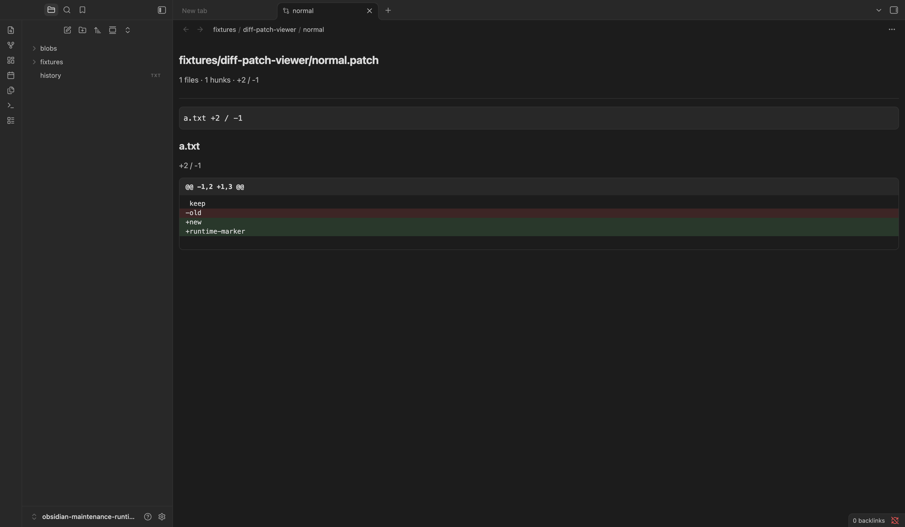

# Obsidian 1.15.1 verification — 16 November 2026

Maintenance patch `0.1.3`. Runtime code is unchanged. The actual desktop host exercised candidate `333513d3e536d515a51cac5224331457518575d1` with exact source, bundle, manifest and CSS hashes. Production main.js SHA-256: `0ace645c5cbf295b11a9720a9750ca815765be656456805fc63f4b37b39b9aa9`.

## Exercised behavior

- Checked fixture-specific expected rendered values for `fixtures/diff-patch-viewer/normal.patch`.
- Toolbar actions were not exercised in this host batch.
- Asserted `raw fallback` for `fixtures/diff-patch-viewer/empty.diff`.
- Asserted `raw fallback` for `fixtures/diff-patch-viewer/malformed.diff`.
- Opened 0 further fixtures as smoke checks for nonempty content and no plugin-load failure; their exact semantic output was not asserted.
- Verified unchanged hashes for every opened input, removed extension/command registrations after detaching leaves, and reloaded the primary fixture with its expected values.

## Environment and validation

Tests use fictional fixtures in a fresh own synthetic vault on macOS arm64, the actual Obsidian 1.15.1 renderer and Electron 39.8.3. A bounded own bootstrap separates the CLI socket and test profile. Mock keychain is enabled; the regular application/CLI and installed original bytes are checked separately. Own test windows may be visible and remain unfocused. No OS mouse or keyboard input is used. The renderer uses an emulated 1800×1050 viewport; no native window geometry/throttle commands are used.

Ordinary locked `npm ci`, TypeScript checking, production build, existing test scripts and production dependency audit passed. Checked-in official `eslint-plugin-obsidianmd` 0.6.0 recommended checks cover source and metadata; existing repository lint guards are retained where present. Generated/test harness artifacts are outside the official production-source lint scope. Development tooling is not shipped.

## Scope limits

Viewer leaves are manually detached before unload; unregister/reload proof does not establish automatic closure of every open leaf.

This establishes the exercised 1.15.1 macOS behavior. It does not establish mobile, minimum-version, native-resize, authentication or real keychain behavior. Official Community source/release review, public asset readback and fresh catalog installation remain separate publication gates; a local build or screenshot alone does not establish them.

## Render evidence

